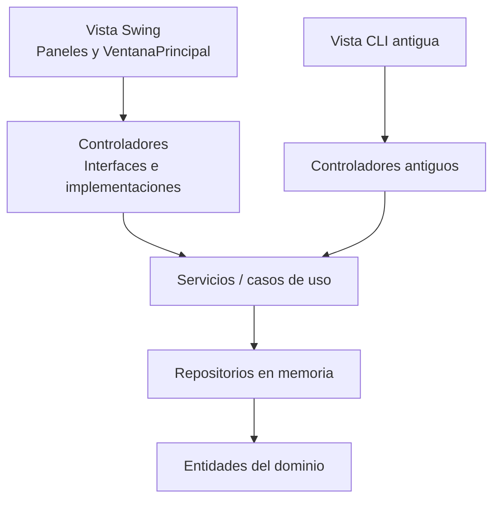

# Sistema de Gestion de Taller Mecanico

Aplicacion Java para gestionar clientes, tecnicos, vehiculos y ordenes de trabajo de un taller mecanico. La interfaz principal es una aplicacion de escritorio Swing; el proyecto conserva ademas una interfaz CLI antigua bajo `vista/cli` y controladores antiguos bajo `controller/old`.

> **Version actual: GUI Swing.** Los paquetes `vista/cli` y `controller/old` corresponden a versiones anteriores del proyecto y se mantienen solo como referencia o compatibilidad de la CLI. `Main.java` ya no inicia `VistaMain`; inicia `VentanaPrincipal` y conecta las implementaciones concretas de `controller/impl`.

## Indice

1. [Resumen funcional](#resumen-funcional)
2. [Tecnologias y requisitos](#tecnologias-y-requisitos)
3. [Como ejecutar](#como-ejecutar)
4. [Arquitectura](#arquitectura)
5. [Flujo completo de una operacion](#flujo-completo-de-una-operacion)
6. [Mapa detallado del repositorio](#mapa-detallado-del-repositorio)
7. [Modelo de dominio](#modelo-de-dominio)
8. [Controladores](#controladores)
9. [Servicios](#servicios)
10. [Repositorios](#repositorios)
11. [Interfaz grafica](#interfaz-grafica)
12. [Validacion y errores](#validacion-y-errores)
13. [Pruebas](#pruebas)
14. [Convenciones para modificar el proyecto](#convenciones-para-modificar-el-proyecto)
15. [Manual de lectura para una IA](#manual-de-lectura-para-una-ia)
16. [Diagramas existentes](#diagramas-existentes)

## Resumen funcional

El sistema permite:

- Registrar, buscar y listar clientes.
- Registrar, buscar y listar tecnicos.
- Registrar automoviles, motocicletas y camiones.
- Buscar un vehiculo por placa.
- Filtrar vehiculos por el ID de su propietario.
- Crear, consultar, cancelar y finalizar ordenes de trabajo.
- Agregar y quitar trabajos realizados.
- Reasignar tecnicos.
- Filtrar ordenes por ID, estado, cliente, tecnico, placa y fecha de ingreso.
- Calcular el costo acumulado de los trabajos de una orden.

Los datos existen mientras la aplicacion esta ejecutandose. Los repositorios usan mapas en memoria y no escriben en una base de datos ni en archivos.

## Tecnologias y requisitos

- Java JDK 25, recomendado por `pom.xml`.
- Maven 3.9 o compatible.
- Swing para la interfaz grafica.
- JUnit Jupiter 5.10.2 para pruebas unitarias.
- Surefire 3.2.5 para ejecutar las pruebas desde Maven.

El proyecto configura:

```xml
<maven.compiler.source>25</maven.compiler.source>
<maven.compiler.target>25</maven.compiler.target>
```

No requiere una conexion externa ni una base de datos.

## Como ejecutar

Desde la raiz del proyecto:

```bash
mvn clean test
mvn package
java -cp target/classes co.edu.uptcsoft.taller.Main
```

El punto de entrada es `src/main/java/co/edu/uptcsoft/taller/Main.java`. Al iniciar:

1. Crea los cuatro repositorios en memoria.
2. Crea las implementaciones de todos los casos de uso.
3. Inyecta esos casos de uso en los controladores concretos.
4. Crea datos iniciales de ejemplo.
5. Construye `VentanaPrincipal`.
6. Muestra la ventana Swing en el hilo grafico `AWT-EventQueue`.

Para solo ejecutar las pruebas:

```bash
mvn test
```

No se debe iniciar `VistaMain` desde `Main` si se quiere abrir la interfaz Swing; `VistaMain` pertenece a la implementacion CLI antigua.

## Arquitectura



Las dependencias se dirigen hacia las interfaces y hacia el repositorio:

```text
vista/gui
   -> controller
   -> model

controller/impl
   -> ControllerValidation
   -> service
   -> model

service/impl
   -> repository
   -> model

repository/impl
   -> model
```

Reglas de dependencia:

- La vista no crea ni accede directamente a repositorios.
- El controlador no contiene reglas de negocio ni accede a repositorios.
- El controlador valida cadenas, normaliza, convierte tipos y delega.
- El servicio valida reglas de estado y relacion de entidades.
- El repositorio guarda y consulta objetos en memoria.
- La clase `Main` actua como contenedor manual de dependencias.

## Flujo completo de una operacion

Ejemplo: registrar un cliente.

```text
PanelClientes
  1. Lee texto de los JTextField.
  2. llama clienteController.registrar(...)

ClienteControllerImpl
  1. requiredText(...) normaliza cadenas.
  2. phone(...) valida telefono.
  3. email(...) valida correo.
  4. llama RegistrarCliente.execute(...)

RegistrarClienteImpl
  1. Busca si el ID ya existe.
  2. Lanza ServiceException si esta duplicado.
  3. Crea Cliente.
  4. Guarda el cliente en ClienteRepository.
  5. Devuelve el Cliente creado.

PanelClientes
  1. Refresca la tabla.
  2. Muestra un mensaje de exito o error.
```

Ejemplo: crear una orden.

```text
PanelOrdenes
  -> OrdenController.crear(...)

OrdenControllerImpl
  -> valida ID
  -> parsea LocalDateTime
  -> valida placa e ID tecnico
  -> optionalText(...) para observaciones
  -> CrearOrdenTrabajo.execute(...)

CrearOrdenTrabajoImpl
  -> verifica que la orden no exista
  -> busca Vehiculo
  -> busca Tecnico
  -> crea OrdenTrabajo con estado EN_PROCESO
  -> devuelve o guarda la orden
```

Las excepciones de formato se crean en el controlador. Las excepciones de negocio se crean en el servicio y se dejan propagar; no se envuelven en otra excepcion.

## Mapa detallado del repositorio

### Punto de entrada

| Archivo | Responsabilidad |
|---|---|
| `Main.java` | Crea repositorios, servicios y controladores, carga datos de ejemplo y abre Swing. |

### Paquete `model`

| Archivo | Responsabilidad |
|---|---|
| `Cliente.java` | Datos de un cliente: ID, nombre, telefono y correo. |
| `Tecnico.java` | Datos de un tecnico: ID, nombre y especialidad. |
| `Vehiculo.java` | Clase base abstracta de vehiculo. Contiene placa, marca, modelo y cliente. |
| `Automovil.java` | Vehiculo con numero de puertas. |
| `Motocicleta.java` | Vehiculo con cilindraje. |
| `Camion.java` | Vehiculo con capacidad de carga. |
| `EstadoOrden.java` | Estados posibles: `EN_PROCESO`, `FINALIZADA` y `CANCELADA`. |
| `OrdenTrabajo.java` | Orden, fechas, estado, vehiculo, tecnico, observaciones y trabajos realizados. |
| `TrabajoRealizado.java` | Descripcion y valor de una tarea realizada en una orden. |

### Paquete `repository`

| Archivo | Responsabilidad |
|---|---|
| `Repository<T>.java` | Contrato generico para guardar, buscar, eliminar, listar y filtrar. |
| `ClienteRepository.java` | Implementacion `HashMap<String, Cliente>`. |
| `TecnicoRepository.java` | Implementacion `HashMap<String, Tecnico>`. |
| `VehiculoRepository.java` | Implementacion `HashMap<String, Vehiculo>` normalizando la placa. |
| `OrdenRepository.java` | Implementacion `HashMap<String, OrdenTrabajo>`. |

### Paquete `controller`

| Archivo | Responsabilidad |
|---|---|
| `ClienteController.java` | Contrato de operaciones disponibles para clientes. |
| `TecnicoController.java` | Contrato de operaciones disponibles para tecnicos. |
| `VehiculoController.java` | Contrato de operaciones disponibles para vehiculos. |
| `OrdenController.java` | Contrato de operaciones disponibles para ordenes. |
| `impl/*ControllerImpl.java` | Validacion, normalizacion, parsing y delegacion a servicios. |
| `impl/ControllerValidation.java` | Utilidad compartida para texto, numeros, correo, telefono, fecha y estado. |
| `old/*.java` | Implementaciones anteriores; se conservan por compatibilidad, pero no son las usadas por el `Main` Swing actual. |

### Paquete `service`

La raiz contiene interfaces. Cada interfaz normalmente tiene su implementacion homonima en `service/impl`.

| Grupo | Casos de uso |
|---|---|
| Clientes | `RegistrarCliente`, `BuscarCliente`, `ListarClientes` |
| Tecnicos | `RegistrarTecnico`, `BuscarTecnico`, `ListarTecnicos` |
| Vehiculos | `RegistrarAuto`, `RegistrarMoto`, `RegistrarCamion`, `BuscarVehiculo`, `ListarVehiculos`, `VehiculosCliente` |
| Ordenes | `CrearOrdenTrabajo`, `AgregarTrabajoAOrden`, `QuitarTrabajoDeOrden`, `ReasignarTecnicoOrden`, `FinalizarOrden`, `CancelarOrden`, `BuscarOrden`, `ListarOrdenes`, `CalcularTotalOrdenes` |
| Consultas | `OrdenesCliente`, `OrdenesEstado`, `OrdenesTecnico`, `OrdenesVehiculo`, `OrdenesFechaIngreso` |

`OrdenesFechaIngreso` filtra las ordenes en el servicio usando un rango inclusivo de fechas. La vista solo obtiene las fechas elegidas y delega la consulta al controlador.

Los nombres son expresivos y cada `execute(...)` representa una accion completa del dominio.

### Paquete `vista/gui`

| Archivo | Responsabilidad |
|---|---|
| `VentanaPrincipal.java` | Contenedor Swing con pestanas. |
| `PanelClientes.java` | Tabla, busqueda y registro de clientes. |
| `PanelTecnicos.java` | Tabla, busqueda y registro de tecnicos. |
| `PanelVehiculos.java` | Tabla, filtros, registro y detalle de vehiculos. |
| `PanelOrdenes.java` | Tabla, filtros, acciones, trabajos y cambio de estado de ordenes. |

### Paquete `vista/cli`

Contiene la interfaz de consola anterior. `VistaMain` presenta un menu, pero `Main` actual no lo inicia. Se conserva para apoyar compatibilidad o migracion gradual.

### Codigo de versiones anteriores

Los siguientes elementos son codigo legacy:

- `controller/old/ControlRegistros.java`
- `controller/old/ControlOrdenes.java`
- `controller/old/ControlConsultas.java`
- `vista/cli/**`
- `vista/VistaMain.java`

No deben usarse como referencia para implementar nuevas operaciones de Swing. La arquitectura vigente usa:

```text
Panel Swing
  -> Controller interface
  -> ControllerImpl
  -> Service interface
  -> ServiceImpl
  -> Repository
```

La migracion desde CLI a Swing no cambia los casos de uso de `service`; crea una nueva entrada de vista y delega los metodos concretos a las implementaciones actuales de los controladores.

### Excepciones

| Clase | Nivel | Uso |
|---|---|---|
| `TallerException` | Base | Extiende `RuntimeException`. |
| `ValidationException` | Validacion | Entrada vacia o formato invalido en el controlador. |
| `ElementoNoEncontradoException` | Negocio | Entidad requerida que no existe. |
| `ServiceException` | Negocio | Reglas o estados invalidos. |

`ServiceException`, `ElementoNoEncontradoException` y `ValidationException` son excepciones no comprobadas porque heredan de `TallerException`, que hereda de `RuntimeException`.

## Modelo de dominio

### `Cliente`

Campos principales:

- `id`: identificador obligatorio.
- `nombre`: nombre completo.
- `telefono`: cadena validada por el controlador.
- `email`: correo validado por el controlador.

### `Vehiculo`

Es una clase abstracta. Nunca debe instanciarse directamente. Sus subtipos son:

- `Automovil`: `numeroPuertas`.
- `Motocicleta`: `cilindraje`.
- `Camion`: `capacidadCargaTon`.

Cada vehiculo contiene una referencia al `Cliente` propietario.

### `OrdenTrabajo`

Campos principales:

- `idOrden`.
- `fechaHoraIngreso`: `LocalDateTime`.
- `fechaHoraEntrega`: `LocalDateTime`, puede ser `null`.
- `estado`: `EN_PROCESO`, `FINALIZADA` o `CANCELADA`.
- `vehiculo`.
- `tecnico`.
- `observacionesIngreso`.
- `observacionesEntrega`.
- `listaTrabajos`: lista independiente que no expone su lista interna directamente.

Una orden no permite agregar o quitar trabajos si no esta en proceso. Las comprobaciones concretas estan en los servicios `AgregarTrabajoAOrdenImpl`, `QuitarTrabajoDeOrdenImpl`, `FinalizarOrdenImpl` y `CancelarOrdenImpl`.

### `TrabajoRealizado`

Representa una tarea ya realizada dentro de una orden:

- `descripcion`.
- `valor`.

El costo total de una orden se calcula sumando los valores de sus trabajos.

## Controladores

Los controladores implementan las interfaces de `controller`.

### Orden de normalizacion

Un metodo debe seguir este orden:

```text
1. comprobar null
2. aplicar trim()
3. comprobar isEmpty()
4. validar formato o convertir tipo
5. llamar execute(...)
```

El flujo esta centralizado en `ControllerValidation`.

Ejemplo logico:

```java
String id = ControllerValidation.requiredText(idEntrada, "id");
int puertas = ControllerValidation.integer(puertasEntrada, "numeroPuertas");
return registrarAuto.execute(id, marca, modelo, idCliente, puertas);
```

El controlador convierte y valida el formato numérico; las reglas de dominio, como exigir valores positivos, se aplican en el servicio.
Las observaciones de ingreso son opcionales y se normalizan a una cadena vacía; las observaciones de entrega son obligatorias para finalizar una orden y el servicio las valida.

No se deben poner consultas a repositorios dentro de un controlador.

## Servicios

Los servicios contienen reglas de negocio. Cada implementacion recibe repositorios por constructor, lo que permite sustituir las implementaciones y facilita las pruebas.

Ejemplo conceptual:

```java
public class BuscarClienteImpl implements BuscarCliente {
    private final Repository<Cliente> clienteRepository;

    public Cliente execute(String idCliente) {
        return clienteRepository
                .buscarPorId(idCliente)
                .orElseThrow(() ->
                        new ElementoNoEncontradoException("El cliente no existe"));
    }
}
```

Cada linea explica un nivel:

- El constructor recibe una dependencia.
- `execute(...)` representa el caso de uso.
- `buscarPorId(...)` devuelve `Optional`.
- `orElseThrow(...)` convierte ausencia en excepcion.
- La implementacion no conoce Swing ni consola.

## Repositorios

Todos usan `Repository<T>`:

```java
T guardar(T elemento);
Optional<T> buscarPorId(String id);
boolean eliminar(String id);
List<T> listar();
List<T> filtrar(Predicate<T> criterio);
```

Puntos importantes:

- Las claves normalmente se guardan tal como llegan al repositorio.
- `VehiculoRepository` normaliza la placa a mayusculas.
- `OrdenRepository` busca la orden por el ID exacto de la clave.
- `listar()` devuelve una copia construida por `List.copyOf(...)`.
- `filtrar(...)` aplica un `Predicate` y devuelve `Stream.toList()`.
- Los datos se pierden al cerrar el programa.

## Interfaz grafica

### Ventana principal

`VentanaPrincipal`:

1. Extiende `JFrame`.
2. Configura titulo, cierre, dimensiones y posicion centrada.
3. Crea los cuatro paneles.
4. Los agrega a un `JTabbedPane`.
5. Refresca el panel seleccionado mediante `addChangeListener`.

### Panel de clientes

Permite crear, buscar por ID y mostrar todos los clientes.

### Panel de tecnicos

Permite crear, buscar por ID y mostrar todos los tecnicos.

### Panel de vehiculos

Permite:

- Registrar automovil, motocicleta o camion.
- Buscar por placa.
- Filtrar por el ID del propietario.
- Mostrar todos los vehiculos.
- Abrir detalles al hacer doble clic.

El refresco obtiene vehiculos por cada cliente registrado. Para una base mas grande seria mas eficiente leer directamente `VehiculosCliente` una vez.

### Panel de ordenes

Permite:

- Crear una orden.
- Filtrar por todos los criterios disponibles.
- Filtrar por rango de fechas `Desde` y `Hasta`.
- Ver detalle y trabajos.
- Agregar o quitar trabajos.
- Reasignar tecnico.
- Finalizar o cancelar una orden.

Las acciones se encuentran en la ultima columna. Swing ejecuta el popup desde el `JTable` visible, no desde un boton interno del editor de celda.

Las acciones que modifican estado se deshabilitan cuando la orden no esta `EN_PROCESO`.

## Validacion y errores

### Texto obligatorio

`requiredText(...)` verifica:

1. `value == null`.
2. `value.trim()`.
3. `normalized.isEmpty()`.

### Enteros

`positiveInt(...)` y `nonNegativeInt(...)` usan `Integer.parseInt(...)` y convierten los errores a `ValidationException`.

### Decimales

`positiveDouble(...)` valida con `\d+(\.\d+)?`, usa `Double.parseDouble(...)` y verifica `Double.isFinite(...)`.

Acepta por ejemplo:

- `10`
- `10.5`
- `0.25`

Rechaza:

- `10d`
- `10f`
- `NaN`
- `Infinity`
- `-10`
- `10,5`

### Telefono

Debe comenzar por `3` y tener exactamente diez digitos:

```text
3\d{9}
```

### Correo

El controlador exige:

- un solo `@`;
- texto antes del `@`;
- texto despues del `@`;
- un punto posterior al `@`;
- ninguna secuencia vacia alrededor del punto.

No reemplaza una validacion RFC completa, solo una validacion funcional apropiada para el taller.

### Fecha y hora

Las fechas de orden se representan con `LocalDateTime`. `LocalDateTime.parse(...)` acepta el formato local ISO:

```text
2026-11-18T13:30
2026-11-18T13:30:15
```

Al crear una orden desde la GUI actual, `LocalDateTime.now()` proporciona la fecha y hora automaticamente. El popup no requiere ingresar estos datos manualmente.

## Pruebas

Las pruebas JUnit se encuentran en `src/test/java`.

| Ruta | Tipo |
|---|---|
| `co/edu/uptcsoft/taller/controller/impl/*Test.java` | Pruebas unitarias planas de controladores y validacion. |
| `serviceTest/*Test.java` | Pruebas manuales o historicas de servicios; no forman el flujo activo de Swing. |
| `vista/cli/*Test.java` | Pruebas manuales relacionadas con la CLI legacy. |

Las pruebas de controladores deben seguir este orden:

1. Entradas invalidas.
2. Campos vacios o nulos.
3. Parsing incorrecto.
4. Casos positivos.
5. Captura de argumentos recibidos por `execute(...)`.
6. Verificacion de valores normalizados y convertidos.

Ejemplo:

```java
@Test
void delegatesNormalizedValues() {
    RegistrarCliente registrar = (id, nombre, telefono, correo) -> {
        assertEquals("123", id);
        assertEquals("Ana Perez", nombre);
        assertEquals("3001234567", telefono);
        assertEquals("ana@dominio.com", correo);
        return null;
    };
}
```

Las pruebas no usan clases `@Nested`.

## Convenciones para modificar el proyecto

### Agregar una operacion

1. Definir la interfaz en `controller` si sera visible desde la vista.
2. Implementarla en `controller/impl`.
3. Definir el caso de uso en `service`.
4. Implementarlo en `service/impl`.
5. Agregar o reutilizar repositorios.
6. Conectar las dependencias manualmente en `Main`.
7. Agregar el control Swing o CLI correspondiente.
8. Agregar pruebas JUnit.
9. Ejecutar `mvn test`.

### Agregar una entidad

1. Crear la clase en `model`.
2. Crear o reutilizar `Repository<T>`.
3. Crear su implementacion de repositorio si hace falta.
4. Crear casos de uso y controladores.
5. Crear el panel correspondiente si la operacion sera visible.

### Modificar una validacion

Cambiar primero `ControllerValidation`. No duplicar validaciones equivalentes en cada vista o servicio.

Diferencia de responsabilidades:

- El controlador rechaza texto vacio o formato invalido.
- El servicio rechaza duplicados, estados invalidos o entidades inexistentes.
- El modelo protege invariantes propias como valores nulos y estados obligatorios.

### Agregar una excepcion

Usar `TallerException` como base para excepciones no comprobadas:

```java
public class MiException extends TallerException {
    public MiException(String message) {
        super(message);
    }
}
```

No declarar `throws` en las interfaces por defecto.

### Cambiar repositorios

El repositorio debe implementar `Repository<T>`. La vista no debe conocer la implementacion concreta. Los servicios reciben `Repository<T>`, no `ClienteRepository` ni `OrdenRepository`, excepto en el ensamblado manual de `Main`.

## Manual de lectura para una IA

Una IA que revise el repositorio debe seguir este proceso:

1. Leer `README.md`.
2. Leer `pom.xml`.
3. Leer `Main.java` para conocer el ensamblado real.
4. Leer las interfaces de `controller`.
5. Leer las implementaciones de `controller/impl`.
6. Leer `ControllerValidation`.
7. Leer las interfaces de `service`.
8. Leer solo las implementaciones relevantes de `service/impl`.
9. Leer `Repository` y la implementacion concreta usada.
10. Leer las clases del paquete `model` relacionadas.
11. Leer el panel Swing que llama a la operacion.
12. Leer las pruebas del controlador o servicio relacionado.

Al explicar una linea de codigo, distinguir:

- **Enlace de entrada/salida**: Swing, consola o `Main`.
- **Validacion**: null, espacios, regex simple, rango o parsing.
- **Normalizacion**: `trim()` o conversion de mayusculas/minusculas.
- **Delegacion**: llamada a `execute(...)`.
- **Regla de negocio**: duplicado, estado, relacion entre entidades.
- **Persistencia**: guardar, buscar, listar o filtrar.
- **Presentacion**: construccion de tabla, dialogo o mensaje.

Al responder sobre una operacion, describir primero:

1. Clase vista que inicia la accion.
2. Metodo del controlador llamado.
3. Valores normalizados y convertidos.
4. Interfaz de servicio usada.
5. Implementacion ejecutada.
6. Repositorio consultado.
7. Entidad creada o modificada.
8. Resultado devuelto.
9. Excepcion posible.

No presentar `controller/old` ni `vista/cli` como la arquitectura Swing activa sin verificar primero la ruta usada por `Main`.

### Prompt recomendado para otra IA

```text
Lee README.md y sigue el manual de lectura para una IA.
Explica el repositorio sin asumir que todos los archivos estan conectados.
Identifica primero el punto de entrada real: Main.java.
Diferencia la arquitectura activa Swing de la CLI antigua.
Rastrea una operacion desde la vista hasta el repositorio.
Explica validacion, delegacion y regla de negocio por separado.
Si una clase no esta referenciada desde Main, avisalo como codigo legacy.
No uses informacion fuera del repositorio salvo que te lo solicite.
```

## Diagramas existentes

El proyecto contiene recursos visuales:

- `src/main/java/co/edu/uptcsoft/taller/diagramageneral.svg`
- `src/main/java/co/edu/uptcsoft/taller/diagramageneral.md`
- `src/main/java/co/edu/uptcsoft/taller/model/diagram.svg`
- `src/main/java/co/edu/uptcsoft/taller/model/diagram.md`
- `src/main/java/co/edu/uptcsoft/taller/model/diagramaSimple.svg`
- `src/main/java/co/edu/uptcsoft/taller/model/diagramaSimple.md`

## Estado de persistencia

No hay base de datos configurada. El estado de prueba se crea en `Main` y la persistencia depende de:

- `HashMap` en memoria.
- Objetos Java vivos durante el proceso.
- Ausencia de serializacion o escritura a disco.
